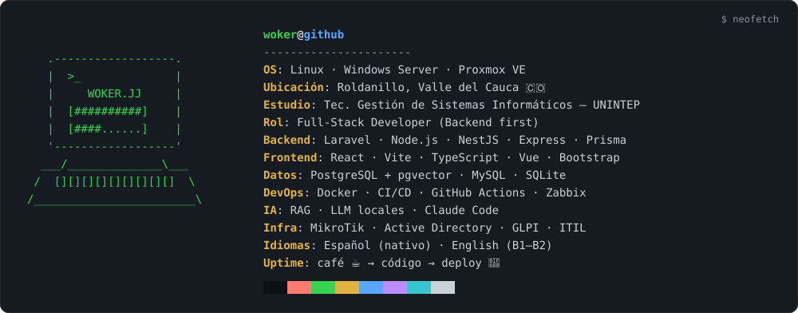

<p align="center">
  
</p>

<!-- 👾 Foto en pixel art: cuando subas tu imagen a assets/pixel-avatar.png, descomenta este bloque
<p align="center">
  
</p>
-->

<p align="center">
  <a href="https://wokerjj.github.io/portafolio">_portafolio-0d1117?style=for-the-badge&logo=gnometerminal&logoColor=39d353" alt="Portafolio"/></a>
  <a href="https://www.linkedin.com/in/jhonhucker"></a>
  <a href="mailto:jchalarcaramirez@gmail.com"></a>
  
</p>

```console
woker@roldanillo:~$ cat about.md
```

> Full-Stack Developer con enfoque **backend** desde Roldanillo, Valle del Cauca 🇨🇴.
> Construyo software que resuelve problemas reales: helpdesks con IA, apps para mi municipio,
> automatización de procesos institucionales e infraestructura monitoreada.
> Me muevo entre el código y el rack: **Laravel · Node.js · NestJS** por un lado, **Proxmox · MikroTik · Zabbix** por el otro.

<p align="center">
  
</p>

---

## `$ ./ahora --building`

```diff
+ resolvia ............ Mesa de ayuda con IA: clasifica tickets de soporte TI y sugiere soluciones (RAG)
                         NestJS · Prisma · PostgreSQL + pgvector · React + Vite · Flutter · Docker
                         monorepo · feat/* → develop · AGPL-3.0 · on-premise + nube multi-organización
                         🎯 meta: v1.0.0 — 18/12/2026

+ veni-roldanillo ..... Todos los restaurantes de Roldanillo en una PWA bilingüe (ES/EN):
                         menús, mapa y pedidos por WhatsApp sin comisión · TypeScript

+ veni-mapa ........... Mapa propio de Roldanillo: extracto OpenStreetMap en PMTiles + estilo MapLibre
```

## `$ ls -la ~/proyectos`

| | Proyecto | Qué hace | Stack |
|:-:|---|---|---|
| 🤖 | [**resolvia**](https://github.com/WokerJJ/resolvia) | Helpdesk inteligente para soporte TI con RAG y LLM local | `NestJS` `React` `pgvector` `Docker` |
| 🍽️ | [**veni-roldanillo**](https://github.com/WokerJJ/veni-roldanillo) | PWA bilingüe de restaurantes con pedidos por WhatsApp | `TypeScript` `PWA` |
| 🗺️ | [**veni-mapa**](https://github.com/WokerJJ/veni-mapa) | Mapa vectorial propio en PMTiles para Vení | `MapLibre` `PMTiles` `OSM` |
| 🔐 | [**control-accesos-laravel**](https://github.com/WokerJJ/control-accesos-laravel) | Control de accesos institucional: ingresos, casilleros con transacciones `FOR UPDATE`, reportes PDF/Excel y dashboard | `Laravel 13` `MySQL` `Pest` `Docker` |
| 🩺 | [**diagnostico-vm-zabbix**](https://github.com/WokerJJ/diagnostico-vm-zabbix) | GUI de diagnóstico de VMs y hosts integrada con Zabbix, histórico y reportes | `Python` `Tkinter` `PostgreSQL` |
| 🏋️ | [**vitality-gym**](https://github.com/WokerJJ/vitality-gym) | Gestión de membresías de gimnasio con triggers, vistas y procedimientos | `Node.js` `Express` `MySQL` |
| 🌱 | [**silvacode-v1**](https://github.com/WokerJJ/silvacode-v1) | API REST para huertos urbanos (FloraCode) con auth JWT y validación Zod | `Express` `Prisma` `JWT` |
| 🎬 | [**miniNetflix**](https://github.com/WokerJJ/miniNetflix) | Motor de recomendación con lista enlazada, grafo de similitud y árbol AVL | `JavaScript` `Estructuras de datos` |
| 🧬 | [**lifeOs-v1**](https://github.com/WokerJJ/lifeOs-v1) | Laboratorio personal de productividad guiado por un único `life_profile.json` | `HTML` `JS` |
| 💻 | [**portafolio**](https://github.com/WokerJJ/portafolio) | Mi portafolio con temática de terminal | `HTML` `CSS` `JS` |

## `$ git log --oneline --graph experiencia`

```text
* 2026-10  feat: veni-roldanillo + veni-mapa — app y mapa propio para mi municipio
* 2026-09  feat: resolvia — helpdesk con IA (NestJS + pgvector), rumbo a v1.0.0
* 2026-06  release: OITEL · Universidad del Valle (Zarzal) — práctica en Desarrollo Web y Soporte TI
|            ↳ envío automatizado de PDFs a 120+ docentes (Node.js + Gmail API + OAuth 2.0)
|            ↳ proceso manual de 2 días → menos de 15 minutos
|            ↳ apps Laravel/PHP para Talento Humano · soporte TI y redes
* 2026-06  feat: control-accesos-laravel — proyecto de grado, migrado de PHP puro a Laravel
* 2025-07  init: Tecnología en Gestión de Sistemas Informáticos — UNINTEP (Roldanillo)
* 2022-04  release: Accedo (Pereira) — pasantía en Programación Web · Laravel · Vue.js
* 2022-04  done: Técnico en Programación y Desarrollo de Software — SENA
* ·······  done: Técnico Profesional en Soporte de Sistemas Informáticos — INTEP
* ·······  cert: Cisco Networking Academy — Networking Basics
```

## `$ cat stack.json`

<p>


<br/>


<br/>


</p>

## `$ top -u WokerJJ`

<p align="center">
  
  
</p>

<!-- 🐍 Snake de contribuciones: se genera con .github/workflows/snake.yml en la rama "output" -->
<p align="center">
  <picture>
    <source media="(prefers-color-scheme: dark)" srcset="https://raw.githubusercontent.com/WokerJJ/WokerJJ/output/snake-dark.svg"/>
    
  </picture>
</p>

```console
woker@roldanillo:~$ echo $MOTTO
"La disciplina tarde o temprano supera al talento."
woker@roldanillo:~$ █
```
